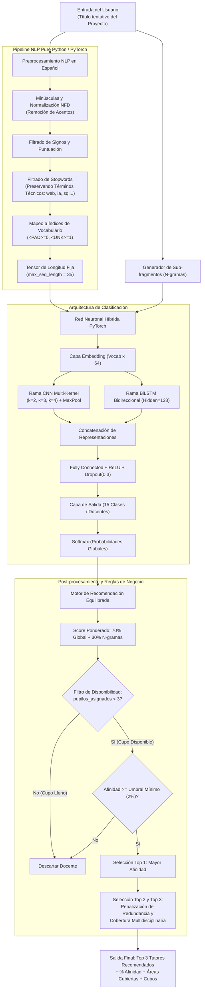
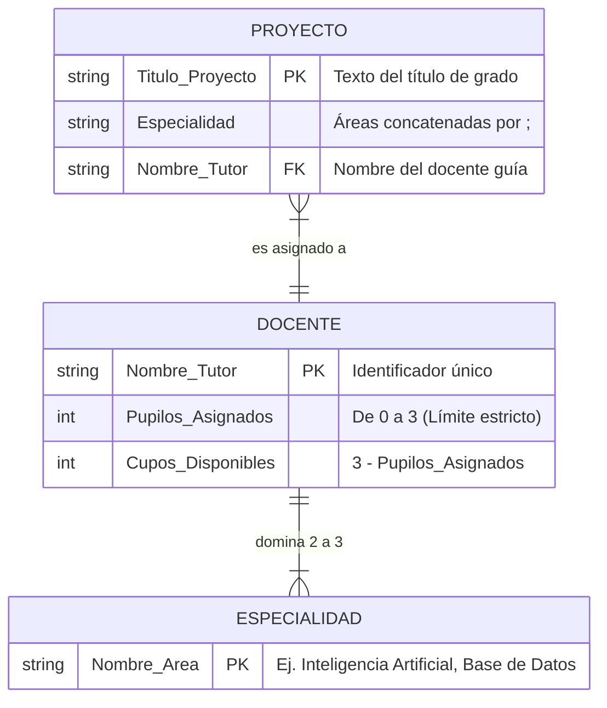

# Documentación de Datos y Arquitectura

En este documento se detallan el flujo de datos, el pipeline de preprocesamiento NLP, la topología de la red neuronal y el motor de decisión para la asignación de tutores.

---

## 1. Diagrama de Flujo del Sistema (End-to-End)

---

## 2. Diagrama Entidad-Relación y Estructura de Datos

---

## 3. Matriz de Distribución del Dataset

El dataset `dataset_tutores_especializados.csv` cuenta con **600 registros perfectamente balanceados**:

| N° | Nombre del Tutor | Especialidades Registradas | Muestras | Cupos Iniciales |
|---|---|---|---|---|
| 1 | **Ing. Marcelo Quiroga** | Inteligencia Artificial; Vision Computacional; Programacion | 40 | 2/3 (1 asignado) |
| 2 | **Lic. Andrea Mendoza** | Procesamiento de Lenguaje Natural; Machine Learning; Programacion | 40 | 3/3 (0 asignados) |
| 3 | **Ing. Roberto Navarro** | Ciencia de Datos; Mineria de Datos; Estadistica Computacional | 40 | 1/3 (2 asignados) |
| 4 | **Ing. Oscar Telleria** | Administracion de Servidores; Ciberseguridad; Informatica Forense | 40 | 3/3 (0 asignados) |
| 5 | **Ing. Luis Arce** | Redes y Telecomunicaciones; Infraestructura de Red; Seguridad Perimetral | 40 | 2/3 (1 asignado) |
| 6 | **Lic. Natalia Gomez** | Ciberseguridad; Criptografia; Auditoria de Sistemas | 40 | 3/3 (0 asignados) |
| 7 | **Ing. Diego Fernando** | Analisis y Diseno de Sistemas; Ingenieria de Requerimientos; Sistemas ERP | 40 | 2/3 (1 asignado) |
| 8 | **Lic. Gabriela Paz** | Base de Datos; Modelado de Datos; Sistemas Transaccionales | 40 | 3/3 (0 asignados) |
| 9 | **Ing. Carlos Vilela** | Desarrollo Backend; Arquitectura de Microservicios; Contenedores Docker | 40 | 1/3 (2 asignados) |
| 10 | **Ing. Valeria Paredes** | Desarrollo Web; Aplicaciones Web Progresivas; Interfaces de Usuario | 40 | 3/3 (0 asignados) |
| 11 | **Ing. Rodrigo Vargas** | Desarrollo Movil; Programacion Multiplataforma; Geolocalizacion | 40 | 2/3 (1 asignado) |
| 12 | **Lic. Fernando Pinto** | Internet de las Cosas; Sistemas Embebidos; Automatizacion | 40 | 3/3 (0 asignados) |
| 13 | **Lic. Pamela Suarez** | Cloud Computing; DevOps; Sistemas Distribuidos | 40 | 2/3 (1 asignado) |
| 14 | **Ing. Martin Lopez** | Algoritmia Avanzada; Optimizacion Matematica; Simulacion de Sistemas | 40 | 3/3 (0 asignados) |
| 15 | **Ing. Claudia Urena** | Realidad Aumentada; Graficacion por Computadora; Simuladores 3D | 40 | 3/3 (0 asignados) |

---

## 4. Algoritmo de Balanceo Multidisciplinario

Para garantizar que un proyecto transversal como *"Sistema web de reconocimiento de cáncer a través de redes neuronales con base de datos PostgreSQL"* no recomiende a 3 docentes de la misma área, se aplica la siguiente heurística:

1. **Puntuación Combinada:**
   $$\text{Score}(t) = 0.7 \cdot P_{\text{global}}(t) + 0.3 \cdot \frac{1}{|F|}\sum_{f \in F} P_{\text{fragmento}}(t, f)$$
2. **Puesto 1:** Se asigna al docente con el mayor $\text{Score}(t)$ que tenga cupo disponible. Sus especialidades se marcan como *cubiertas*.
3. **Puestos 2 y 3:** Entre los candidatos restantes con cupo y afinidad por encima del umbral (2%), se prioriza a aquellos cuyas especialidades aporten áreas **no cubiertas** por los docentes ya elegidos. Si se cubren todas o no hay complementarios, se asignan por mayor puntuación.

